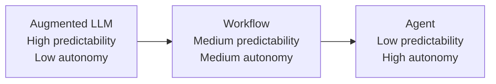
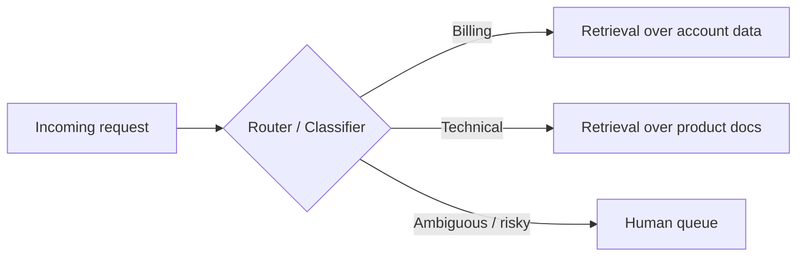
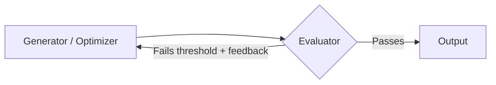
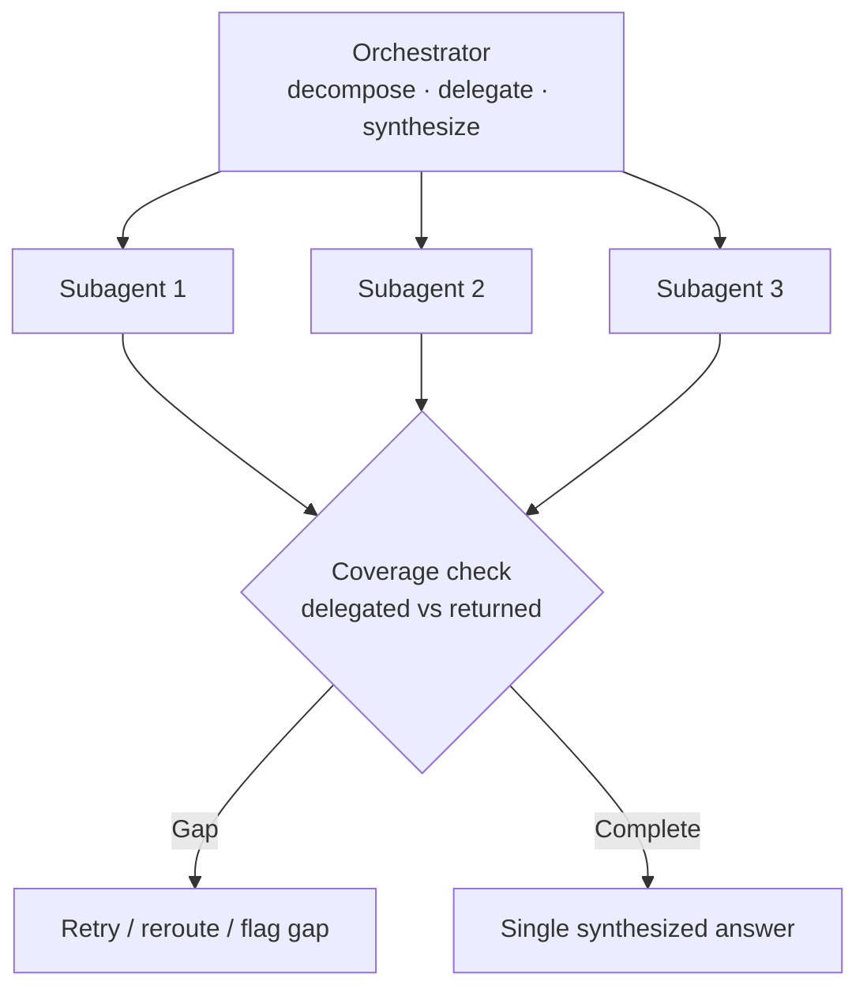
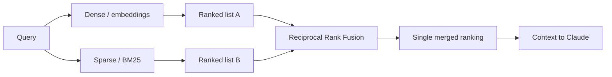

# Claude Certified Architect – Professional (CCAP / exam code CCAR-P) — Architecture Study Notes

> Personal exam-prep notes, transcribed and organized from handwritten notebook pages.
> Focus: designing solutions with Claude, choosing between patterns, multi-agent design, reference architectures, and RAG.

---

## Table of Contents

1. [Core Principle: Design Beyond Model Choice](#1-core-principle-design-beyond-model-choice)
2. [What Claude Is (and Isn't) Good At](#2-what-claude-is-and-isnt-good-at)
3. [Entry Points, Build Interfaces & Delivery Surfaces](#3-entry-points-build-interfaces--delivery-surfaces)
4. [Division of Labour: Claude vs Existing System vs Human](#4-division-of-labour-claude-vs-existing-system-vs-human)
5. [The Three Patterns: Augmented LLM, Workflow, Agent](#5-the-three-patterns-augmented-llm-workflow-agent)
6. [Workflow Sub-Patterns](#6-workflow-sub-patterns)
7. [Pattern Comparison Matrix](#7-pattern-comparison-matrix)
8. [Choosing Between Agent and Workflow](#8-choosing-between-agent-and-workflow)
9. [Multi-Agent: Orchestrator & Subagents](#9-multi-agent-orchestrator--subagents)
10. [When to Consider Fine-Tuning](#10-when-to-consider-fine-tuning)
11. [Reference Architectures](#11-reference-architectures)
12. [RAG Deep Dive: Chunking & Indexing](#12-rag-deep-dive-chunking--indexing)
13. [Quick-Recall Cheat Sheet](#13-quick-recall-cheat-sheet)
14. [Self-Test Questions](#14-self-test-questions)

---

## 1. Core Principle: Design Beyond Model Choice

**Designing a solution with Claude goes beyond just choosing a model.**

For every task, decide three things:

| Question | Meaning |
|---|---|
| **What goes to Claude?** | Language work: understanding, summarizing, planning, drafting |
| **What goes to the existing system?** | Deterministic work: lookups, policy decisions, calculations, records |
| **What goes to the human?** | Judgment, exceptions, approvals |

> Optimize for the **present** requirement as well as **unknown future flexibility** — but use the **fewest primitives** that reach your design goal.

---

## 2. What Claude Is (and Isn't) Good At

### Capability comes from next-token prediction
Claude is strongest on **tasks built on common patterns**:
- Summarization
- Reformatting
- Explaining well-established concepts

### Compensating for weaknesses

| Problem | Design response |
|---|---|
| Hallucination risk on facts | Use **citations**, **uncertainty signalling**, and **generate → verify loops** |
| Factual lookups | **Route factual lookups through tool calls** — don't trust model recall |
| Freshness & authority | **Re-introduce the data yourself** (put the authoritative source in context) |
| Unreliable / fast-changing topics | **Web search / retrieval tools / MCP** |
| Hitting context/token limits | **Check the `usage` field on every response** + use the **token counting API** before sending |

---

## 3. Entry Points, Build Interfaces & Delivery Surfaces

| Layer | Question | Options |
|---|---|---|
| **Entry point** | *Who* reaches Claude? | Claude.ai, Claude Code, Claude Desktop |
| **Build interface** | *How* does code reach Claude? | Claude SDK, Direct API, MCP, Agent SDK |
| **Delivery surface** | *Where* does the response land? | The UI / channel / system where output is consumed |

### Primitives — use the fewest that reach the design goal
- MCP
- Tools
- Skills
- Hooks
- Subagents
- Agent teams
- Dynamic workflows

---

## 4. Division of Labour: Claude vs Existing System vs Human

| Actor | Does | Verbs |
|---|---|---|
| **Claude** | Understanding, summary, planning, drafting, tool-mediated action | Read, extract, summarize, draft |
| **Existing system** | Policy engine, order-status service, order table, database record | Decide, look up, return, tell, calculate |
| **Human** | Judgment, exceptions, approval | Approve — *moments where getting it right matters more than being fast* |

> **Human review where there is risk** — e.g., *issuing a refund*.

### Worked example: insurance/claim email
| Step | Owner |
|---|---|
| Reading & interpreting the claim (extract / summarize / draft) | ✅ Claude |
| Deciding priority | ❌ Not Claude — deterministic decision function |
| Looking up policy coverage | Existing system via **MCP** |
| Drafting the reply email | ✅ Claude |
| Actually *sending* the email | MCP / tool (not Claude's judgment) |
| Review / escalation | Human |

---

## 5. The Three Patterns: Augmented LLM, Workflow, Agent

### 5.1 Augmented LLM (model + tools)
- **Single model invocation**: send → model completes → **code handles the rest**
- Only **one bundled job in one pass**
- Use when:
  - Task is **well defined**
  - Output is something **you can verify**
  - There is **no reason to split** it

### 5.2 Workflow
- **Named steps**, **orchestrated from code**
- Steps **may or may not call Claude**
- **Control flow lives in code, not inside the model**
- Use when:
  - **Error cost is real**
  - **Observability matters**
  - **Steps are predefined**

### 5.3 Agent
- **Goal + tools** → the **model decides the sequence** of steps to reach the goal
- **Control flow lives in the model, not in code**
- Use when:
  - **Path is unknown**
  - Cost may be unpredictable / inconsistent (and that's acceptable)
  - **Output is auditable & recoverable**
- An agent must be **bounded by**:
  - Constrained tools
  - Per-turn / turn budget
  - Explicit permissions
  - Stopping criteria

### 5.4 Autonomy vs Predictability
**Autonomy is inversely related to predictability.**

| Situation | Pattern |
|---|---|
| You know the task **and** know what good looks like | Augmented LLM |
| Overall shape is predictable, but each step may involve the model | Workflow |
| Path genuinely unknown | Agent |

---

## 6. Workflow Sub-Patterns

| Pattern | How it works | Example |
|---|---|---|
| **Chaining** | Step 2 takes Step 1's output as input — **sequential, linear** | Extract → summarize → draft |
| **Routing** | A **classifier (often Claude itself)** decides what to do next | Billing question → retrieval index over **account data**; technical question → retrieval index over **product docs**; or **escalate directly to a human queue** |
| **Parallelization** | Run subtasks at once **when they are independent** | Analyze several documents simultaneously |
| **Evaluator–Optimizer** | One model **attempts** the output, a second **evaluates** it, and revisions continue in a **loop until a quality threshold is reached** | Structured extraction with validation |
| **Orchestrator–Workers** | Orchestrator decomposes, delegates, and synthesizes (see §9) | Multi-source research |

---

## 7. Pattern Comparison Matrix

| Dimension | Augmented LLM *(model + tool)* | Workflow | Agent *(chooses own tool sequence, open-ended)* |
|---|---|---|---|
| **Predictability** — do you know the steps? | Yes → high | Yes → high | No → low |
| **Error cost** — if wrong, how much damage? | Medium (some damage) | Low (guarded steps) | High |
| **Observability** — can you see what happened? | Medium — targeted call is visible, but what happens inside the model is not | High — every step can be logged | Low — hard to know what happened / what's left |
| **Latency budget** | Low (as configured — but **extended thinking adds time**) | Medium (duration can exceed) | High |
| **Cost** | Low | Medium | High |

> ⚠️ **Agents do NOT always cost more than workflows.**
> Cost is driven by **context accumulation** and **number of model calls made**. A **poorly designed workflow can cost more** than a well-bounded agent.

---

## 8. Choosing Between Agent and Workflow

| If… | Choose |
|---|---|
| **Steps genuinely unknown**, work unpredictable | **Agent** |
| **Steps known** — same extraction every time, gaps must be auditable | **Workflow** |
| You're adding **so many guardrails/tools inside the agent** that it's really a **workflow in an agent loop** | Rethink — it should probably be a **workflow** |

**Rule:** use the **fewest agents that meet the requirement**.

---

## 9. Multi-Agent: Orchestrator & Subagents

### Orchestrator responsibilities
1. **Decompose** the work
2. **Decide when to delegate**
3. **Synthesize** the results into a single answer
4. **Never does the subtask itself**

### Failure handling

| Failure | Recoverable? | Response |
|---|---|---|
| **Subagent failure** | ✅ Recoverable | Orchestrator **retries**, **routes it elsewhere**, or **drops it and flags the gap** |
| **Orchestrator failure** | ❌ Not recoverable | Must be prevented — **protect orchestrator state** |

### Design rules
- Subagent work must be **idempotent & retryable**
- **Protect orchestrator state**
- Use the **same trace identifiers** across orchestrator and subagents (end-to-end observability)

### Watch / validate / verify the subagent boundary
- **Coverage check at synthesis** — e.g., *80 results delegated, only 48 returned by subagents* → the gap must be detected and reported
- Look for **recurring failures** at the boundary
- 🚩 Classic failure mode: **confident synthesis over incomplete work**

---

## 10. When to Consider Fine-Tuning

Fine-tuning is the **last** resort. Escalate in this order:

1. **Optimize the prompt**
2. **Add tools or retrieval**
3. **Move to a stronger pattern** (e.g., evaluator–optimizer)
4. **Then** consider fine-tuning

---

## 11. Reference Architectures

### 11.1 Agent
**Use for:** investigating, pulling from multiple sources, triaging complex customer cases.

**Bound it by:** limiting what tools can do; setting a budget (**turns**).

🚩 **Red flags to look for:**
- Unbounded agent
- No human review before **changing state** (agent acts on its own)
- No turn limit
- No measure of the goal (no success criteria)

### 11.2 RAG (Retrieval-Augmented Generation)
- **Stable knowledge corpus** (manuals, docs, text) → **chunked & indexed**
- Question → **most relevant chunk is picked** → **passed to the model as context**

**RAG can't:**
- Answer about **live state** — order status, inventory levels, ticket queues
- Stay current: **the index is a snapshot** → when underlying data changes, **answers go wrong**

### 11.3 Document Processing Pipeline → *Evaluator–Optimizer*
**Use for:** structured extraction from semi-structured documents — claims, invoices, contracts.

**Pipeline handles:** OCR → extract fields against the schema → validate the output → route exceptions.

- LLM fills the document schema
- **Optimizer = generator**, **Evaluator = validation**
- **Evaluator layers:**
  - **Code-level** checks (schema, types, required fields)
  - **LLM** only for **judgment calls** (e.g., *was this contract clause classified correctly?*)

🚩 **Red flags:**
- No exception path
- **Low-confidence extraction passes as a clean document**
- No human gate

### 11.4 Customer Service / Ticket Triage → *Routing*
- **Clarify intent** — what is the user actually asking? — then **route to the right backend**
- Routing targets:
  - **Knowledge layer** (RAG)
  - **Transactional API** for live state
  - **Human review**
- **Simple routing before an agent**

### 11.5 Coding Agent
**Agentic exploration + deterministic edit/test/review step.**

1. **Investigate** (agentic)
2. **Actual edit** → pause → plan → propose → test → review

🚩 **You can't:**
- Edit **without human review**
- Skip **tracking the regression rate**

### 📌 Notes
- **Separate eval set for each architecture.**
- **Retrieval principle:** **RAG for FAQs** (stable knowledge) · **Tool use for live data**

---

## 12. RAG Deep Dive: Chunking & Indexing

### 12.1 Chunking — *how you break the corpus*
> The **chunk** is the unit that **gets retrieved**.

| Strategy | How | Best for |
|---|---|---|
| **Fixed-size** | Uniform spans (with overlap), regardless of structure | Homogeneous, unstructured text where natural boundaries are weak — **simplest to start** |
| **Semantic** | Split on **meaning boundaries / topic shifts** (sentences that hang together) | When the **retrieved chunk must be self-contained** to answer well |
| **Hierarchical** | **Preserve document structure** — sections, subsections; retrieve at the level that fits | **Structured docs** (contracts, policies, manuals) where **section context carries meaning** |

### 12.2 Indexing — *how you make chunks findable (given how queries are phrased)*

| Index | Matches on | Best for |
|---|---|---|
| **Dense (embeddings)** | **Semantic similarity** — meaning, not words | Queries phrased differently from the source (paraphrase, intent, conceptual matching) |
| **Sparse (keyword / BM25)** | **Exact terms**, code identifiers, names | Part numbers, statute citations, error codes |
| **Hybrid** | **Both** | Mixed query patterns — **the common production case** |

### 12.3 Hybrid Index & Reciprocal Rank Fusion (RRF)
- A hybrid index produces **two ranked lists** (sparse + dense) → they must be **merged into one**
- **Reciprocal Rank Fusion** does this:
  - Each result is **scored by its rank in each list**
  - The **combined score favours items that rank well in both** sparse and dense

> 💡 Formula (for reference): `RRF(d) = Σ 1 / (k + rank_i(d))`, typically `k = 60`. Uses ranks only, so no need to normalize the different score scales of BM25 and embeddings.

---

## 13. Quick-Recall Cheat Sheet

- **Model choice ≠ design.** Split work between Claude / system / human.
- **Facts → tools. Freshness → inject data yourself. Limits → `usage` field + token counting API.**
- **Augmented LLM:** one call, well-defined, verifiable.
- **Workflow:** control flow in code; real error cost; observability; known steps.
- **Agent:** control flow in model; unknown path; auditable & recoverable output; bounded (tools, budget, permissions, stop criteria).
- **Autonomy ↑ = Predictability ↓.**
- **Agents aren't always pricier** — context accumulation + call count drive cost.
- **Fewest agents / fewest primitives that meet the requirement.**
- **Orchestrator never does subtasks.** Subagent failure = recoverable; orchestrator failure = not.
- **Idempotent subagents, protected orchestrator state, shared trace IDs, coverage checks.**
- **Fine-tune last:** prompt → tools/retrieval → stronger pattern → fine-tune.
- **RAG = stable knowledge; tools = live state.** Index is a snapshot.
- **Doc pipeline:** code-level validation first; LLM evaluator only for judgment.
- **Triage:** simple routing before an agent.
- **Coding agent:** human review on edits + track regression rate.
- **Separate eval set per architecture.**
- **Chunking:** fixed (simple) · semantic (self-contained) · hierarchical (structured docs).
- **Indexing:** dense (meaning) · sparse/BM25 (exact terms) · hybrid (production) merged via **RRF**.

---

## 14. Self-Test Questions

<b>Q1.</b> A support bot must answer "Where is my order #12345?" Your team proposes adding order data to the RAG index. What's wrong?

The index is a snapshot — order status is **live state**. Use a **tool call / transactional API** (e.g., via MCP), not RAG.

<b>Q2.</b> An orchestrator delegated 80 research tasks; the final report looks complete, but only 48 subagent results came back. What's the failure mode and fix?

**Confident synthesis over incomplete work.** Add a **coverage check at synthesis**; retry, reroute, or **flag the gap** in the output.

<b>Q3.</b> An "agent" has a fixed tool order enforced by hooks, a hard-coded sequence of permissions, and the same steps every run. What should it be?

A **workflow** — it's a workflow running inside an agent loop. Control flow belongs in code.

<b>Q4.</b> Users search a legal corpus by both natural-language questions and exact statute citations. Which index?

**Hybrid** (dense + sparse/BM25), merged with **Reciprocal Rank Fusion**. Hierarchical chunking also fits, since section context carries meaning.

<b>Q5.</b> Extraction quality on invoices is poor. The team wants to fine-tune immediately. What should they try first?

1. Optimize the prompt → 2. Add tools/retrieval → 3. Move to evaluator–optimizer (code-level validation + LLM judgment) → 4. Only then fine-tune.

<b>Q6.</b> Which should decide a refund: Claude, the policy engine, or a human?

Claude **reads and drafts**; the **policy engine decides eligibility/amount**; a **human approves** where there's risk (issuing the refund).

<b>Q7.</b> A subagent crashes mid-task. Is that a design problem?

Not if subagent work is **idempotent & retryable** — the orchestrator can retry, reroute, or flag. An **orchestrator** crash is the unrecoverable one, so **protect orchestrator state**.

<b>Q8.</b> Name four red flags in an agent design.

Unbounded; no human review before state changes; no turn limit; no measure of the goal.

---

*Source: handwritten study notes (9 pages). A few hard-to-read words were interpreted from context. The RRF formula is a reference addition.*
